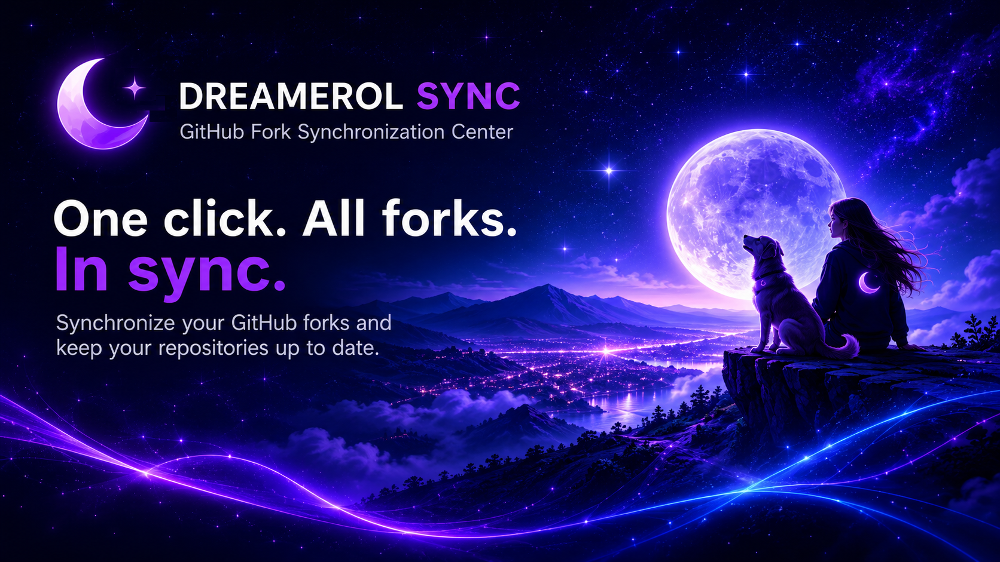

 

<table>
<tr>

<td align="center" width="12%">
🌐 
<a href="https://dreamerol.github.io/MIHAELA-KOSEVA-AI/">𝗪𝗘𝗕𝗦𝗜𝗧𝗘</a>
</td>

<td align="center">│</td>

<td align="center" width="12%">
⚛️ 
<a href="https://github.com/Dreamerol/AI-STUDIO">𝗔𝗜𝗦𝗧𝗨𝗗𝗜𝗢</a>
</td>

<td align="center">│</td>

<td align="center" width="12%">
🟢 
<a href="https://github.com/Dreamerol/PORTFOLIO">𝗣𝗢𝗥𝗧𝗙𝗢𝗟𝗜𝗢</a>
</td>

<td align="center">│</td>

<td align="center" width="12%">
🧩 
<a href="https://github.com/Dreamerol/CARDFOLIO">𝗥𝗘𝗣𝗢𝗦</a>
</td>

<td align="center">│</td>

<td align="center" width="12%">
📊 
<a href="https://github.com/Dreamerol/ALLSTATS">𝗦𝗧𝗔𝗧𝗦</a>
</td>

<td align="center">│</td>

<td align="center" width="12%">
✅ 
<a href="https://github.com/Dreamerol/RESUME">𝗥𝗘𝗦𝗨𝗠𝗘</a>
</td>

<td align="center">│</td>

<td align="center" width="12%">
🔗 
<a href="https://www.linkedin.com/in/mihaela-koseva-software-engineer">𝗟𝗜𝗡𝗞𝗘𝗗𝗜𝗡</a>
</td>

<td align="center">│</td>

<td align="center" width="12%">
✉️ 
<a href="https://raw.githubusercontent.com/Dreamerol/Dreamerol/main/MIHAELA_KOSEVA_VIZITKA.jpg">𝗖𝗢𝗡𝗧𝗔𝗖𝗧</a>
</td>

</tr>
</table>

 

 

<h1 align="center">
  🌙 <a href="https://github.com/Dreamerol"
     title="GitHub Fork Synchronization Center — DREAMEROL SYNC">
    <b>𝗗𝗥𝗘𝗔𝗠𝗘𝗥𝗢𝗟 𝗦𝗬𝗡𝗖</b>
  </a>
</h1>

 

### ⚡ Keep your GitHub forks synchronized effortlessly.

DREAMEROL SYNC is a Python-powered application designed to simplify GitHub fork management through an intuitive, user-friendly graphical interface.

It automatically discovers GitHub forks associated with an authenticated account and provides a streamlined way to request upstream synchronization through the official GitHub API.

From its welcoming onboarding experience to its interactive Dashboard, DREAMEROL SYNC brings fork discovery, management, and synchronization together in one convenient place.

**Simple to use. Secure by design. Built for effortless GitHub workflows.** 🧩⚡

> 💜 Simple workflow. Secure authentication. Reliable synchronization. And a tiny bit of magic ✨.

 

### ⚡ Keep your GitHub forks synchronized effortlessly.

DREAMEROL SYNC is a Python-powered application designed to simplify GitHub fork management through an intuitive, user-friendly graphical interface.

It automatically discovers GitHub forks associated with an authenticated account and provides a streamlined way to request upstream synchronization through the official GitHub API.

From its welcoming onboarding experience to its interactive Dashboard, DREAMEROL SYNC brings fork discovery, management, and synchronization together in one convenient place.

**Simple to use. Secure by design. Built for effortless GitHub workflows.** 🧩⚡

> 💜 Simple workflow. Secure authentication. Reliable synchronization. And a tiny bit of magic ✨.

 

## ✨ Requirements

Before getting started, make sure you have:

- 💻 **Visual Studio Code**
- 🔧 **Git**
- 🐍 **Python 3.11+**

 

## 🚀 Quick Start

**1. Install the GitHub App** – Install [DREAMEROL SYNC](https://github.com/apps/dreamerol-sync) and authorize access to your repositories.

**2. Clone the project** – Get DREAMEROL SYNC on your local computer.

**3. Open and enjoy the app! 🎉** – Open the project in VS Code, launch your preferred AI assistant (Copilot, Claude Code, OpenCode, or another), and ask it to start DREAMEROL SYNC and open the Dashboard in your browser.

**That's it! Welcome to DREAMEROL SYNC.** 🌙

 

## 🖥️ Application Screenshots

 

   

 

 

 

 
 

## 📘 Detailed Technical Documentation

For a complete technical overview of DREAMEROL SYNC, including system architecture, implementation details, GitHub App authentication, Auth Broker, API, security, and deployment specifications, see:

📄 **[DREAMEROL SYNC — Technical Guide](https://github.com/Dreamerol/DREAMEROL-SYNC/blob/main/docs/00%20-%20DREAMEROL%20SYNC%20-%20TECHNICAL%20GUIDE.md)**

📄 **[DREAMEROL SYNC — Detailed Technical Documentation](https://github.com/Dreamerol/DREAMEROL-SYNC/blob/main/docs/01%20-%20DREAMEROL%20SYNC%20-%20DETAILED%20TECH%20DOC.md)**

 

## ✅ Release status

DREAMEROL SYNC is a working open-source project. The repository started from a partial implementation and now contains the full tested codebase. The following has been verified automatically:

- Python 3.11+ with `pip install -r requirements.txt`.
- `python -m pytest -q` → 506 passing tests.
- `python main.py --help` and a fresh clone from this repository both work.
- The `Tests` workflow passes on Ubuntu and Windows with Python 3.11 and 3.12 (4 jobs).
- MIT License; no paid features, subscriptions or monetization.

### Requires your own setup

- Your own GitHub credentials: a personal access token or GitHub App credentials. `.env` and secrets are not committed.
- Local loopback callback for the GitHub App (`127.0.0.1:8000`).

### Not covered by automated CI

- Real GitHub App sign-in/callback and installation permissions — these need your own GitHub App configuration.
- Mutating synchronization against your live repositories — CI runs read-only tests only.
- Remote HTTPS/TLS proxy deployment (`COOKIE_SECURE=true` or `--proxy-headers`).
- Multi-worker sessions and a separate CSRF token are not part of this release.

Use dry-run preview first. Nothing in the CLI or Dashboard performs a live sync without explicit confirmation.

 

## 📜 License and author information

This project is licensed under the MIT License.

See the [LICENSE](LICENSE) file for details.

Made by Dreamerol.

Synchronize your forks. Simplify your workflow.

 

## 💜 DREAMEROL

Made with ❤️ by Dreamerol.

🌙 DREAMEROL SYNC

Synchronize your forks. Simplify your workflow.

---

 

<h2 align="center">⭐ Explore repos & star what you find interesting</h2>

Mihaela Koseva • Sofia University • SMG (СМГ) • Sofia • AI Engineer • Software Engineer • Data Systems & APIs • Applied Machine Learning • Computer Vision • Neural Networks • Model Training • Data Science • LLMs • Python • C++ • Java • SQL • PyTorch • TensorFlow • Scikit-learn • Pandas • NumPy • ETL • Data Modeling • MLOps • Git • GitHub: Dreamerol • github.com/Dreamerol

© 2026 Mihaela Koseva (Михаела Косева) • Софийски университет • Original portfolio design.

🔗 Explore on GitHub:
<a href="https://github.com/Dreamerol">Mihaela Koseva (Михаела Косева) • Software Engineer • AI • ML • Dreamerol</a>

   

   

<table align="center" cellspacing="0" cellpadding="2">
<tr>

<td>

</td>

<td>

</td>

<td>

</td>

<td>

</td>

<td>

</td>

</tr>
</table>

   

